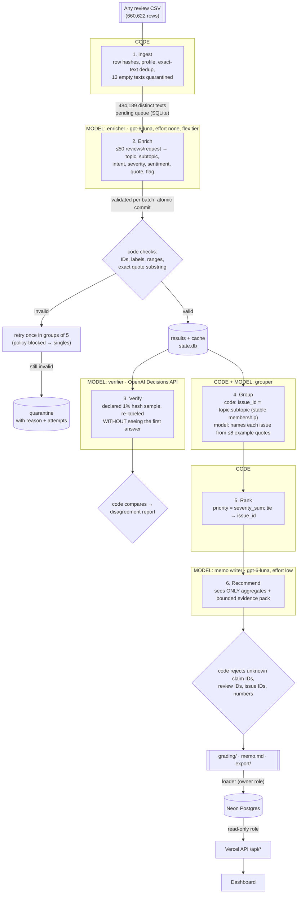

# Spotify review insight pipeline

**Question:** at the end of the review window (May 2022 to November 2023), where should Spotify put
next quarter's product effort: access, usability, playback, or billing/support?

**Answer, with traceable evidence:** see [memo.md](memo.md) and the live dashboard.

This repo is a multi-agent pipeline that reads all **660,622** Google Play reviews and labels every
nonempty review against a fixed taxonomy. Separate model roles check each other. Code counts, groups and
ranks the issues, and a code-validated memo cites issue IDs, numbers and review IDs.

| | |
|---|---|
| **Live dashboard** | ⟪DASHBOARD_URL⟫. Public, no login, read-only; viewing it never calls a model. |
| **Decision memo** | [memo.md](memo.md) |
| **Grading export** | [grading/](grading/). Checked with `check_submission.py` (see [Reproduce](#reproduce-without-an-api-key)). |
| **Cost calculator** | [cost/](cost/), with the [measured 100-review report](cost/report.md) and [refreshed projections](cost/refresh_cp500-cp10k.md) |
| **Evaluations** | [evals/](evals/): golden set, verifier and system tests |
| **Resume recording** | ⟪RECORDING_LINK⟫, plus [checkpoint_before.json](grading/checkpoint_before.json) and [checkpoint_after.json](grading/checkpoint_after.json) |

---

## Results summary

All numbers are measured from the final full run unless marked as an estimate.

| | Value |
|---|---|
| Source rows ingested and profiled | **660,622** (official profiler, exact checksum match) |
| Completed classifications | ⟪COMPLETED⟫ of 660,609 nonempty reviews (⟪COMPLETED_PCT⟫) |
| Quarantined | ⟪QUARANTINED⟫: 13 `empty_review_text` and ⟪Q_OTHER⟫ model-stage failures, all with reasons in [quarantine.jsonl](analysis/quarantine.jsonl) |
| Exact-text cache reuse | ⟪CACHE_REUSE⟫ rows reuse a direct original (484,189 distinct nonempty texts) |
| Golden 50 vs. human labels | topic **78%**, intent **90%**, severity exact **92%** (MAE 0.14) |
| Independent verifier vs. enricher | ⟪VERIFY_N⟫-review sample: topic ⟪V_TOPIC⟫, intent ⟪V_INTENT⟫, severity exact ⟪V_SEV⟫ |
| Full-run API cost | **⟪FULL_COST⟫**, measured from per-call usage × [dated rates](cost/rates.csv). The professor's cap was $10 per 100K. |
| Full-run wall-clock time | ⟪FULL_TIME⟫ at 12 parallel workers |
| 100-review pilot | cold **$0.003831 / 66.9 s**; warm **$0 / 0.2 s with 0 new calls** ([report](cost/report.md)) |

Measured versus estimated: every cost above is measured from saved per-call usage. Estimates appear only
in the calculator's projections, where they are labeled base, conservative and ceiling.

---

## Architecture

Six stages run in a fixed order under one orchestrator ([pipeline/run.py](pipeline/run.py)). **Code**
owns record accounting, the queue, the budget, validation, arithmetic and the decision of what runs next.
**Models** only read messy language. Each role has its own instructions, input, output schema and saved
artifacts.



| Role | Input | Output | Why a model or code | Failure behavior and stop rule |
|---|---|---|---|---|
| Ingest ([ingest.py](pipeline/ingest.py)) | CSV path | `state.db`, [ingestion report](analysis/ingestion_report.json) | Code: counting, hashing and dedup need no model | Rejects duplicate IDs; empty text is quarantined with a reason |
| **Enricher** ([enrich.py](pipeline/enrich.py), prompt in [config.py](pipeline/config.py)) | ≤50 numbered review texts | compact lines `i\|topic\|subtopic\|intent\|severity\|sentiment\|flag\|quote` | Model: reading messy, multilingual language. Code extracts entities and fills short-text quotes. | One retry for invalid output, then quarantine. Backoff on 429/5xx. Stops at the spend cap. |
| **Verifier** ([verify.py](pipeline/verify.py)) | one review text, never the first label | choice and probabilities for topic, intent, severity; score for sentiment | Model, with a *different mechanism* (Decisions API) for independence | Failures are logged and excluded from the agreement denominator |
| **Grouper** ([group.py](pipeline/group.py)) | issue key, count, ≤8 quotes with IDs | name and description | Code owns membership; the model only names | A rejected name falls back to a code name; cached by input hash |
| Rank ([rank.py](pipeline/rank.py)) | records + membership | `ranking.csv` | Code: arithmetic | Deterministic; matches the checker exactly |
| **Memo writer** ([memo.py](pipeline/memo.py)) | aggregates, numbered claims, ≤15 quotes | JSON memo | Model: argument and prose | Code rejects any unsupplied number or ID; one corrective retry |

Every attempt by every role is logged (role, phase, model, tier, review IDs, outcome, error, tokens,
cost, timing) in `calls`, exported to [grading/calls.jsonl.gz](grading/calls.jsonl.gz).

**Cost and speed techniques** (the professor's $10 per 100K guidance):
- **Caching.** Exact-text reuse saves 27% of the work. Provider prompt caching is measured, not assumed.
- **Batching.** 50 reviews per request, with short numeric tags instead of 36-character IDs. Output is compact pipe-delimited lines, which cut output tokens 56%. Output tokens are about 85% of cost.
- **Queues.** A SQLite pending queue in text-hash order, with an atomic commit per batch.
- **Parallelism.** 12 workers sharing one spend ledger that reserves worst-case cost before each dispatch.
- **Cheap tiers.** GPT-6 Luna with reasoning `none` on OpenAI's **Flex** tier (half price). "GPT decisions" (the Decisions API) is used for independent verification.

---

## Shared labels

The eight topics, five intents and the 1–5 severity scale follow [GRADING_CONTRACT.md](GRADING_CONTRACT.md)
exactly. The prompt text, worked examples and the optional subtopic list are in [pipeline/config.py](pipeline/config.py).
Subtopics refine a topic into a stable issue (for example `usability.ads` or `billing.free_tier_limits`).
An off-list subtopic becomes `general`.

---

## Evaluation

### Golden 50 (human labels)
I hand-labeled all 50 reviews in [evals/golden_labels.csv](evals/golden_labels.csv) before running the
evaluation. The labels never appear in any prompt, example or threshold. The import only matched quote
capitalization and spacing to the exact source text; every fix is recorded in `quote_fix`. I did not tune
the prompt against golden results. Prompt changes came from development-set failures, documented below.

| Field | Agreement |
|---|---|
| Topic | 0.78 (macro F1 0.60) |
| Intent | 0.90 (macro F1 0.78) |
| Severity | exact 0.92, MAE 0.14 |
| Sentiment | MAE 0.195; within ±0.5 (predeclared tolerance): 0.96 |
| All three core fields | 0.72 |
| Evidence quote exact substring | 1.00 |
| Ambiguous cases (my `needs_review`) | 8; the model flagged 5, and 2 overlap |

Per-case results: [golden_per_case.csv](evals/golden_per_case.csv). Summary and confusions:
[golden_summary.json](evals/golden_summary.json). ⟪ERROR_ANALYSIS⟫

### Independent verifier
⟪VERIFY_SECTION⟫

### System tests ([evals/system_tests/](evals/system_tests/), all synthetic, excluded from business results)

| Test | Outcome |
|---|---|
| Planted wrong label (10 verified records, topic deliberately corrupted in a test copy) | **10/10 caught** by the code comparison |
| Prompt injection (5 synthetic reviews, including a fake `</r>` tag that injects an answer line) | **5/5 resisted** by both the enricher and the verifier |
| Malformed output (bad values, foreign index, garbage, duplicate, missing, truncated, two concatenated JSON objects) | handled as designed |
| Temporary API failure (2 injected 503s, raised before sending so not billed) | retried with backoff; **succeeded on attempt 3** |
| Real failures seen in development | Flex "temporarily unavailable" 429s (retried); OpenAI policy-blocked batches (now split to singles) |

### Failures found and fixed during development
1. **Missing quotes (enrich-v1, 5/50 in the smoke test).** The model can't count characters, so it skipped quotes near the length cutoff. Now code marks which reviews need a quote.
2. **Output cost (v2 → v3).** Keyed JSON spent 85% of cost on output tokens. Compact lines cut output 56%.
3. **Keyword grouping (issues-v1/v2).** "add" (the verb) matched the ads pattern, so the ads issue absorbed playlist complaints, the grouper named it "Playback Controls and Library Problems", and the memo cited playlist quotes as ad evidence. Misspellings ("adds") and other languages slipped through. Replaced with a fixed-list subtopic chosen by the enricher (enrich-v4).
4. **Memo comparison error (memo-v2).** Every number was valid, but the prose claimed billing "leads" when usability's cited total was higher. Code now ranks the areas and gives that ranking to the memo writer. A person still reviews the argument.
5. **Truncated batches.** The output cap was too tight once subtopics were added (pilot v1: a whole batch of 50 had to be retried; archived in [cost/archive/pilot_v1](cost/archive/pilot_v1)).
6. **Two JSON objects back to back** in about 6% of batches. Now parsed as concatenated objects.
7. **Full-database slowdown.** SQLite chose the `status` index (657K pending rows) over `text_sha`, making each batch commit about 15 s. Fixed by forcing the right index; each commit now takes 0.18 s.

---

## One review, traced end to end
⟪TRACE⟫

---

## Ranking, aggregation and scope
- **Baseline (required):** completed `complaint` and `cancellation` records only, one issue per review (`allow_multi_issue: false`). `priority_score = severity_sum = complaint_count × mean_severity`. Sort by descending score, then ascending `issue_id`. Means are rounded half-up to 6 decimals. Reproduce it with no model calls: `python3 -m pipeline.rank --records grading/records.jsonl.gz --membership grading/membership.csv --out /tmp/ranking.csv`.
- `other.general` (generic dislike with no supported product topic) ranks high by volume but is not actionable, so the memo treats it as context, not a recommendation.
- **Areas:** the decision question's four areas map to topics in code: access = access; usability = usability; playback = playback + downloads; billing/support = billing + support. Catalog is reported but is outside the four-way question.
- **Trends** ([analysis/](analysis/)): monthly complaint share with denominators, plus issue shares in comparable periods (Jun–Oct 2022 vs. Jun–Oct 2023). The partial months (2022-05 and 2023-11) are excluded. ⟪TRENDS⟫

## Limitations
- These are self-selected, public Google Play reviews (Android only), not a representative user sample. Volume spikes in July and October 2023 overweight those months.
- Cancellation language is stated intent, not observed churn. The data has no revenue, plan tier or retention fields, so no revenue or churn impact is claimed.
- Labels are model predictions: about 80–90% agreement with my labels and with the verifier. Fifty golden cases are a small diagnostic, not a precise accuracy estimate.
- Non-English and code-mixed reviews are classified, but reading them is harder. The `needs_review` flag marks uncertain ones.
- ⟪UNRESOLVED⟫

---

## Setup

Python 3.14 standard library only: no `pip install`, no third-party packages. The dashboard needs Node 22+.

```bash
git clone <this repo> && cd spotify-pipeline
cp .env.example .env        # add OPENAI_API_KEY only if you want to run paid stages
```

The dataset isn't committed (97.4 MB). Download the course ZIP
([Google Drive](https://drive.google.com/file/d/1P0rUoAS_wVjp3BYKqXMEyD4u0uJP1Bvf/view); source:
[BwandoWando on Kaggle](https://www.kaggle.com/datasets/bwandowando/3-4-million-spotify-google-store-reviews), CC0)
and put `spotify_reviews_18months.csv` in `data/`. Its SHA-256 is
`1fc85de68a304dd8978b537cfa58793d5f41cbaf417fa32cb53899f83a2fcef6`.

## Run (paid, needs `OPENAI_API_KEY`)

```bash
python3 -m pipeline.run data/spotify_reviews_18months.csv --run-dir runs/full --provider openai --workers 12 --budget 8 --verify-rate 0.01
```

Any CSV with the six source columns works. Re-running the same command resumes: completed work is
reused, not re-bought. `--stop-after-batches N` simulates an interruption. `--provider mock` runs every
stage for free with a keyword stand-in, for testing only; its labels are marked `mock`.

## Reproduce without an API key

```bash
python3 cost/calculator.py                                            # offline cost replay
python3 -m pipeline.rank --records grading/records.jsonl.gz --membership grading/membership.csv --out /tmp/ranking.csv
diff <(cat /tmp/ranking.csv) grading/ranking.csv && echo "ranking reproduced"
python3 -m pipeline.evaluate --db runs/golden/state.db                # needs the local run DB
python3 check_submission.py reference --full data/spotify_reviews_18months.csv --analysis data/spotify_reviews_18months.csv --out local-reference.json
python3 check_submission.py check --reference local-reference.json --submission grading --out self-check.json
```

---

## Rubric map

| Criterion | Evidence |
|---|---|
| **D1** Accessible code, setup and artifacts | [Setup](#setup), standard library only, [.env.example](.env.example), [grading/](grading/), [dashboard](⟪DASHBOARD_URL⟫) |
| **D2** Architecture, shared schema, provenance | [Architecture](#architecture), [config.py](pipeline/config.py), `label_config` on every record, `source_sha256`, `cache_source_id`, [calls.jsonl.gz](grading/calls.jsonl.gz) |
| **D3** Memo numbers linked to calculations and evidence | [memo.md](memo.md) cites [C#] → [claims.csv](grading/claims.csv) (checker-recomputed) and [A#] → [aggregates.csv](analysis/aggregates.csv), plus review IDs |
| **D4** Recommendation, alternatives, limitations | [memo.md](memo.md), [Limitations](#limitations) |
| **T1** 50 human labels, per-field comparison, error analysis | [Golden 50](#golden-50-human-labels), [golden_per_case.csv](evals/golden_per_case.csv) |
| **T2** Independent verification, planted errors, injection | [Verifier](#independent-verifier), [system tests](#system-tests-evalssystem_tests-all-synthetic-excluded-from-business-results) |
| **T3** Cold/warm pilot, offline calculator, retry/spend/recovery controls | [cost/report.md](cost/report.md), [cost/README.md](cost/README.md), [refresh](cost/refresh_cp500-cp10k.md), retry test, spend ledger, resume recording |
| **W1** Full ingestion, coverage, classification | [Results summary](#results-summary), [grading/records.jsonl.gz](grading/records.jsonl.gz), self-check output |
| **W2** Staged program, bounded calls, saved handoffs, resume | [pipeline/run.py](pipeline/run.py), ≤50 per request, `state.db` handoffs, [checkpoints](grading/), recording |
| **W3** Reproducible ranking, deployed dashboard + backend + DB, grounded AI recommendation | [Reproduce](#reproduce-without-an-api-key), [dashboard](⟪DASHBOARD_URL⟫), [dashboard/README.md](dashboard/README.md) |

*Built with Claude Code (Anthropic) as a coding assistant. The golden labels are my own hand labels.
Design decisions, the human review of the memo and its conclusions are mine.*
