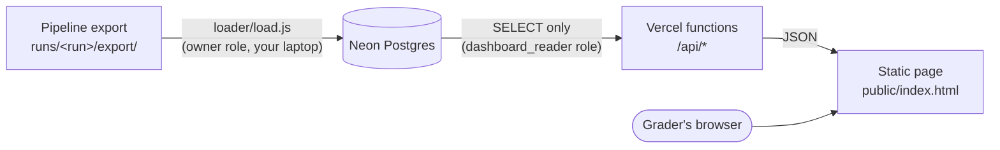

# Review-analysis dashboard

A public, read-only web dashboard for the review pipeline's results: headline
metrics, the baseline issue ranking, and the AI-written recommendation with
every cited number and review traceable back to the database.

- **Frontend:** plain HTML, CSS and JavaScript in `public/` (no build step, no framework).
- **Backend:** five small Vercel serverless functions in `api/`.
- **Database:** Neon Postgres. The website connects with a **read-only** role.
- **Loader:** `loader/load.js`, run on your laptop to copy a pipeline export into the database.

Viewing the dashboard never calls an AI model. It only reads what the pipeline
already saved.

## How the pieces fit



Plain-text version:

```
pipeline export  --(loader, owner role)-->  Neon Postgres  --(read-only role)-->  /api/*  -->  web page
```

| Route | What it returns |
|---|---|
| `GET /api/summary` | Counts (ingested, classified, quarantined, complaint share), cost, golden/verifier agreement, topic/intent/severity distributions, monthly complaint share **with numerator and denominator** |
| `GET /api/ranking` | `ranking.csv` exactly, plus issue names |
| `GET /api/memo` | Memo text, with each `[Cn]` claim's value looked up in the `claims` table, and each cited review's quote |
| `GET /api/issues/:id` | One issue's stats, severity breakdown, monthly trend and up to 20 evidence reviews |
| `GET /api/reviews/:id` | One review: full text + evidence quote for evidence reviews; labels only for all others |

Every route queries Postgres on each request (responses are cached by Vercel's CDN for 5 minutes).

## What is stored, and why it fits the free tier

| Table | Rows | What |
|---|---|---|
| `records` | one per source review (660,622) | labels only: status, topic, intent, severity, sentiment, issue, month, stars, flags. **No review text.** |
| `evidence` | a few hundred | full text + evidence quote, only for reviews cited in the memo or used as issue examples |
| `issues`, `ranking`, `claims`, `memo` | small | copied from the export |
| `agg_monthly`, `agg_distribution`, `agg_issue_monthly` | small | totals computed by Postgres during loading, so pages load fast |
| `runs` | one per loaded run | `run_summary.json` plus recounted totals |

Measured with a 660,622-row synthetic export (`npm run size-estimate`):
**about 148 MB** for one full run, of Neon's 512 MB free tier. Keep at most
two runs; `--drop-other-runs` keeps only the newest.

## Setup and deploy (about 20 minutes)

You need Node 22 or newer. In this environment run `export PATH="/usr/local/bin:$PATH"` first.

```sh
cd dashboard
npm install
npm test          # local check with an in-memory Postgres, no internet needed
npm run dev       # preview at http://localhost:3000 using the synthetic fixture
```

### 1. Create the database

Create a Neon project (for example "Review Dashboard") at console.neon.tech. Copy
the **owner** connection string (role `neondb_owner`) from *Connect*.

### 2. Create the tables

Either paste `schema.sql` into the Neon SQL editor and run it, or let the loader
do it in step 4 with `--schema`. Running it again is safe.

This also creates the `dashboard_reader` role. It can only `SELECT`, cannot
create tables, and every session is forced read-only.

### 3. Let the read-only role log in

In the Neon SQL editor (as the owner), give it a long random password
(for example, the output of `openssl rand -base64 24`):

```sql
ALTER ROLE dashboard_reader WITH LOGIN PASSWORD 'paste-a-long-random-password-here';
```

Its connection string is the owner's string with the user and password swapped:

```
postgresql://dashboard_reader:<password>@<same-host-as-owner>/neondb?sslmode=require
```

### 4. Load a pipeline export

The loader runs on your laptop with the **owner** string. Never put the owner string in Vercel.

```sh
export LOADER_DATABASE_URL='postgresql://neondb_owner:...'
node loader/load.js ../runs/<run>/export --schema
```

The whole load runs in one transaction. It deletes any rows already loaded
for that `run_id`, inserts 5,000 records per statement, computes the
aggregates, then **recomputes the ranking from the records and aborts if it
differs from `ranking.csv`**. If anything fails, the previous data stays as it
was. Re-running the same command is safe. A local test loaded 660K rows in
about 15 seconds; expect a few minutes over the network to Neon.

Options: `--run-id NAME` overrides the run ID, `--no-current` loads a run
without showing it, and `--drop-other-runs` removes every other run.

### 5. Deploy to Vercel

```sh
npx -y vercel@latest link                          # first time: create/link a project; root = this dashboard folder
npx -y vercel@latest env add DATABASE_URL production   # paste the dashboard_reader string
npx -y vercel@latest --prod
```

If you deploy from GitHub instead, set the Vercel project's **Root Directory** to `dashboard`.
Environment variables belong to the Vercel *project*. Add them before the first
production deploy, or the API will return errors.

### 6. Check it

Open the site in a private window (no login should be needed) and visit
`/api/ranking`. Its numbers should match `ranking.csv`.

## Testing

- `npm test` starts **PGlite**, which is real Postgres compiled to WebAssembly
  and running in memory. It runs `schema.sql`, loads `fixtures/synthetic-export/`
  with the real loader, then calls the real API handlers **as `dashboard_reader`**.
  It checks every number against the fixture files: the ranking matches
  `ranking.csv` exactly, every memo citation resolves, and monthly denominators
  add up. It also checks that the read-only role cannot write, that reloading
  is idempotent, and that a tampered `ranking.csv` is rejected without
  damaging the existing data.
- `npm run size-estimate` performs the full-size dry run described above.
- `npm run fixture` regenerates the synthetic fixture.

Only the database connection differs between the tests and production. The
SQL and the handler code are the same.

## Files

```
dashboard/
  public/            index.html, styles.css, app.js  (the page)
  api/               summary.js, ranking.js, memo.js, issues/[id].js, reviews/[id].js
  lib/db.js          shared query helper (Neon driver, JSON responses, GET-only)
  loader/load.js     export folder -> Postgres
  schema.sql         tables, indexes, read-only role
  fixtures/          SYNTHETIC export for development (not real data) + generator
  tests/             run-tests.js, size-estimate.js
  dev-server.js      local preview server (not deployed)
  vercel.json, package.json, .env.example
```

## Export contract the loader expects

`records.jsonl.gz` (or `.jsonl`), `membership.csv`, `ranking.csv`,
`issues.json`, `claims.csv`, `memo.json`, `evidence.jsonl`, `run_summary.json`.
Each record also needs `review_month` (`YYYY-MM`), `review_rating` and
`issue_id`. `membership.csv` is treated as the source of truth for issue
membership, with one issue per review (`allow_multi_issue: false`).

## Disclaimer

This is an independent student analysis of publicly posted app reviews. It is
not affiliated with or endorsed by Spotify or any app maker. The dashboard
uses no logos or brand marks.
